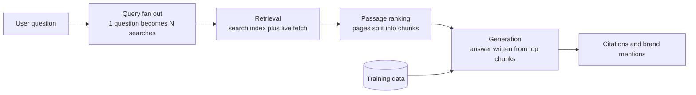

# AI Visibility Toolkit

> 🔭 Four small command line tools for the measurable parts of AI visibility: crawler access, page readiness, prompt coverage and answer scoring. Python standard library only. No API keys, no accounts, no dashboard to host.

AI visibility is how often, how early and how favourably an AI system names your brand or cites your pages when someone asks it a question. This repo turns that vague goal into four numbers you can compute on your own machine: a page readiness score, a crawler hit count, a mention rate with a confidence interval, and a share of voice.

```text
$ python -m avt audit https://www.example.com/aeo --html data/page.good.html --robots data/robots.example.txt
AI readiness score: 97/100  https://www.example.com/aeo

[PASS] robots_retrieval  20 pts  6/6 retrieval bots allowed on /aeo
[PASS] server_text       15 pts  311 words in the server rendered HTML
[PASS] answer_first      12 pts  first paragraph is 29 words
...
training bots blocked (not scored): GPTBot, ClaudeBot, CCBot
```

## 📚 Contents

- [GEO, AEO and friends](#-geo-aeo-and-friends)
- [How an AI answer gets built](#-how-an-ai-answer-gets-built)
- [Quick start](#-quick-start)
- [Command 1: audit](#-command-1-audit)
- [Command 2: logs](#-command-2-logs)
- [Command 3: fanout](#-command-3-fanout)
- [Command 4: score](#-command-4-score)
- [Crawler reference](#-crawler-reference)
- [Repo layout](#-repo-layout)
- [Limits you should know about](#-limits-you-should-know-about)
- [FAQ](#-faq)
- [Contributing](#-contributing)

## 🧬 GEO, AEO and friends

Three acronyms cover the same job from different angles. They are not competing disciplines.

| Term | Stands for | The question it asks | Where the toolkit helps |
|---|---|---|---|
| **AEO** | Answer engine optimization | Can an engine pull a direct answer out of my page? | `audit` |
| **GEO** | Generative engine optimization | Does the generated answer mention or cite me? | `fanout`, `score` |
| **LLMO** | Large language model optimization | Does the model know my brand at all? | `score` on prompts without browsing |
| **SEO** | Search engine optimization | Does my page rank in a list of links? | out of scope, but it feeds retrieval |

Classic SEO still matters because most answer engines start by retrieving pages from a search index. Everything below is about what happens after that step.

## 🧠 How an AI answer gets built



Each stage has something you can influence and something you can measure.

| Stage | What you control | Failure mode | Toolkit command |
|---|---|---|---|
| Fan out | Which sub questions your content answers | You answer the head question and miss the sub questions | `fanout` |
| Retrieval | robots.txt rules, sitemaps, server rendered text | The crawler is blocked or sees an empty shell | `audit`, `logs` |
| Passage ranking | Answer first writing, headings, one claim per section | The right page loads but the wrong passage wins | `audit` |
| Generation | Entity clarity, consistent naming across the web | The model blends you with a similar brand | `score` |
| Citation | Structured data, fresh dates, quotable figures | You are mentioned but never linked | `score` (citation rate) |
| Training data | Whether you allow training crawlers | A policy choice, not a bug | `audit` (reported, not scored) |

Several engines split one question into multiple searches before answering. Google calls this pattern query fan out. It is the reason a page can lose to a competitor on the question people type and still win on the sub questions the engine actually runs.

## ⚡ Quick start

Python 3.10 or newer. Nothing to install.

```bash
git clone https://github.com/SharonVivenix/ai-visibility-toolkit.git
cd ai-visibility-toolkit
python -m unittest discover -s tests      # 13 tests, no network
python -m avt --help
```

Optional editable install that gives you an `avt` command:

```bash
pip install -e .
avt audit https://your-site.example/page
```

## 🔬 Command 1: audit

Scores one page from 0 to 100 on twelve checks. It fetches the page, `/robots.txt`, `/llms.txt` and `/sitemap.xml` with a plain `avt` user agent, or runs offline with `--html` and `--robots`.

```bash
python -m avt audit https://your-site.example/page
python -m avt audit https://your-site.example/page --json --fail-under 80   # CI gate
```

| Check | Points | Passes when |
|---|---|---|
| `robots_retrieval` | 20 | The six search and user fetch bots are allowed on that path. Partial credit per bot |
| `server_text` | 15 | The raw HTML holds at least 300 words (half credit from 100) |
| `answer_first` | 12 | The first real paragraph after the h1 is 15 to 70 words |
| `jsonld` | 10 | At least one `application/ld+json` block parses |
| `headings` | 8 | One h1, two or more h2, no skipped levels |
| `entity_markup` | 7 | `JSON-LD` declares Organization, Person, Product, Article or similar |
| `https`, `sitemap`, `title_meta`, `canonical`, `freshness` | 5 each | Self explanatory, see `avt/audit.py` |
| `llms_txt` | 3 | `/llms.txt` returns 200. Low weight on purpose, see [limits](#-limits-you-should-know-about) |

Training crawlers (`GPTBot`, `ClaudeBot`, `CCBot` and others) are listed but never scored. Blocking them is a legitimate policy decision and the audit does not call it a defect.

## 🪵 Command 2: logs

Counts AI crawler requests in any combined format access log (nginx and Apache default). It tells you which bots arrive, which pages they ask for and how many of those requests succeed.

```bash
python -m avt logs /var/log/nginx/access.log
```

```text
420 requests parsed, 0 lines skipped

bot               operator      purpose     hits    2xx  top paths
ClaudeBot         Anthropic     training      26    81%  /private/reports, /robots.txt, /pricing
OAI-SearchBot     OpenAI        search        26    88%  /sitemap.xml, /pricing, /docs/api
PerplexityBot     Perplexity    search        19    84%  /blog/what-is-aeo, /private/reports, /llms.txt
GPTBot            OpenAI        training      17    76%  /blog/schema-guide, /pricing, /docs/api
```

Read it like this: a search bot with a low 2xx share is being turned away by your server or CDN, and that is usually the cheapest visibility bug to fix. User agent strings can be faked, so treat the counts as a lower bound on honesty. Operators publish IP ranges you can check against when it matters.

## 🧪 Command 3: fanout

Expands a JSON file of prompt templates into a tracking set. One template with a `{persona}` slot and a `{competitor}` slot becomes a grid of concrete prompts, deduplicated and given a stable id.

```bash
python -m avt fanout data/fanout.example.json --brand "Lumen Notes" > prompts.jsonl
```

```json
{"id": "2eaf6ed4", "intent": "discovery", "prompt": "best note taking app for a student"}
{"id": "c221b81c", "intent": "discovery", "prompt": "best note taking app for a product manager"}
```

The example config yields 18 prompts across four intents: discovery, comparison, problem and brand. Run each one against the engines you care about, store the answers as JSON Lines, and feed them to `score`.

## 📈 Command 4: score

Reads stored answers and computes four numbers per engine, prompt, week or overall.

```bash
python -m avt score data/responses.sample.jsonl \
  --brand "Lumen Notes" --domain lumennotes.example \
  --competitor Quillpad --competitor Notebase --by engine
```

```text
engine         runs  mention          95% CI   cited  avg pos    SoV
chatgpt          48     58%    0.44 to 0.71     33%     1.39    35%
claude           48     52%    0.38 to 0.66     35%     1.52    31%
gemini           48     48%    0.34 to 0.62     29%     1.48    30%
perplexity       48     79%    0.66 to 0.88     46%     1.58    40%
```

| Metric | Definition |
|---|---|
| **Mention rate** | Share of runs whose answer names the brand or an alias on a word boundary, case insensitive |
| **95% CI** | Wilson score interval on the mention rate, so 12 runs and 400 runs are not read the same way |
| **Citation rate** | Share of runs where any cited URL is on your domain or a subdomain of it |
| **Avg pos** | Mean rank of your first mention among all tracked names in the answer. 1 means named first |
| **SoV** | Your mentions divided by all tracked mentions across the group |

Input format, one JSON object per line:

```json
{"prompt_id": "p01", "engine": "chatgpt", "ts": "2026-10-05", "answer": "Popular options include ...", "citations": ["https://www.lumennotes.example/blog/what-is-aeo"]}
```

The files in `data/` are synthetic and use fictional brands. Regenerate them with `python data/make_sample_data.py`.

## 🤖 Crawler reference

Registry lives in [`avt/bots.py`](avt/bots.py). Operators document their own crawlers, so check their pages before you rely on a row: [OpenAI](https://platform.openai.com/docs/bots), [Perplexity](https://docs.perplexity.ai/guides/bots), [Google](https://developers.google.com/search/docs/crawling-indexing/overview-google-crawlers).

| Token | Operator | Purpose | In `robots_retrieval` |
|---|---|---|---|
| `OAI-SearchBot` | OpenAI | search | ✅ |
| `ChatGPT-User` | OpenAI | user fetch | ✅ |
| `Claude-SearchBot` | Anthropic | search | ✅ |
| `Claude-User` | Anthropic | user fetch | ✅ |
| `PerplexityBot` | Perplexity | search | ✅ |
| `Perplexity-User` | Perplexity | user fetch | ✅ |
| `GPTBot` | OpenAI | training | reported only |
| `ClaudeBot` | Anthropic | training | reported only |
| `CCBot` | Common Crawl | training | reported only |
| `Bytespider` | ByteDance | training | reported only |
| `meta-externalagent` | Meta | training | reported only |
| `Amazonbot` | Amazon | mixed | reported only |
| `Google-Extended` | Google | control token | reported only, never appears in logs |
| `Applebot-Extended` | Apple | control token | reported only, never appears in logs |

The robots.txt evaluator in [`avt/robots.py`](avt/robots.py) follows the matching rules of [RFC 9309](https://www.rfc-editor.org/rfc/rfc9309): the longest matching pattern wins, Allow beats Disallow on a tie, `*` is a wildcard and `$` anchors the end.

## 🗂️ Repo layout

```text
ai-visibility-toolkit/
├── avt/
│   ├── bots.py        crawler registry and user agent classifier
│   ├── robots.py      RFC 9309 style robots.txt evaluator
│   ├── audit.py       HTML parser plus the twelve weighted checks
│   ├── logs.py        combined log parser and bot aggregation
│   ├── fanout.py      template expansion with stable ids
│   ├── score.py       mention, citation, position, SoV, Wilson interval
│   └── cli.py         argparse entry point
├── data/              synthetic logs, answers, a sample page and policy
├── tests/             13 unittest cases, no network
└── .github/workflows/ test run on every push
```

## ⚠️ Limits you should know about

- **One answer is an anecdote.** Models sample. The same prompt asked twice can name different brands. Use the confidence interval, run each prompt several times and compare weeks, not single runs.
- **The audit measures readiness, not rank.** A 97 does not mean an engine will cite you. It means the cheap, checkable obstacles are gone.
- **Weights are judgement.** The point values in `audit.py` are a reasonable default and nothing more. Edit them to match your own priorities.
- **`llms.txt` is unproven.** It is a community proposal described at [llmstxt.org](https://llmstxt.org/). No major engine has said it reads the file, so it carries 3 points out of 100.
- **Answer first is a heuristic.** The check looks at paragraph length after the h1. It cannot tell whether the paragraph is actually a good answer.
- **Engines change.** Crawler names, policies and retrieval behaviour move. Treat the registry as a starting point and verify against operator docs.
- **The sample data is synthetic.** The fictional brand and its numbers exist to show the output format, not to describe any real market.

## ❓ FAQ

**Is GEO different from AEO?**
In practice the work overlaps almost entirely. AEO emphasises extractable answers, GEO emphasises being named inside generated text. The same page edits serve both.

**Should I block GPTBot and ClaudeBot?**
That is a content licensing decision. Blocking a training crawler does not block the search and user fetch bots from the same operator, which use different tokens. The audit reports training blocks without penalising them.

**Why do server rendered words matter?**
Some crawlers read the raw HTTP response and never execute JavaScript. If your content is injected client side, they receive an empty shell. The `server_text` check counts words in that raw response.

**Does schema markup make AI cite me?**
There is no public evidence of a guaranteed effect. Structured data states plainly what a page is, who wrote it and when it changed, which removes ambiguity. Treat it as hygiene, not a lever.

**Can I use this in CI?**
Yes. `avt audit URL --fail-under 80` exits with status 1 below the threshold, so a deploy pipeline can gate on it.

## 🤝 Contributing

Issues and pull requests are welcome. Good first contributions: new crawler tokens with a link to the operator's documentation, a parser for another log format, a JSON Lines exporter for a response collection script, and tighter tests around robots.txt edge cases. Keep the project dependency free and run `python -m unittest discover -s tests` before you open a pull request.

## 📄 License

MIT. See [LICENSE](LICENSE).
